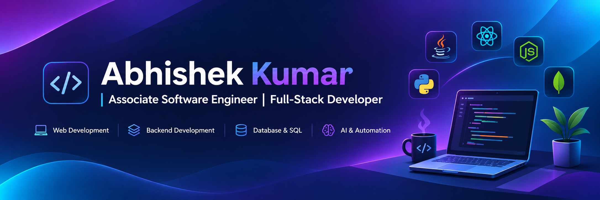
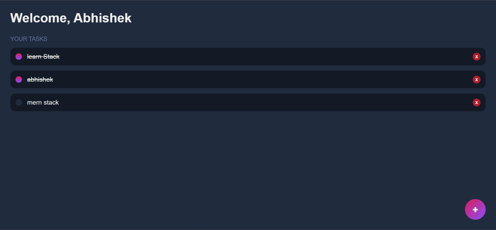

 

  

<h2 align="center">Hi, I'm Abhishek Kumar 👋</h2>

<h3 align="center">Associate Software Engineer | Full-Stack Developer | AI & Data Science</h3>

  Building modern web applications, intelligent software solutions and data-driven products.

  
  

---

## 💫 About Me

- 💼 Associate Software Engineer at Accenture
- 💻 Full-Stack Developer focused on building modern web applications
- 🤖 Interested in Artificial Intelligence and Machine Learning
- 📊 Data Science practitioner with experience in data analysis and predictive modeling
- 🧠 Strong foundation in programming, problem-solving and database management
- 🚀 Passionate about building practical software products and intelligent applications
- 🤝 Open to freelance projects, technical collaborations and development opportunities

---

## 🛠️ Technical Expertise

### 💻 Programming Languages

  
  
  
  
  
  

### 🌐 Full-Stack Development

  
  
  
  
  
  

### 🗄️ Databases

  
  
  

### 🤖 Artificial Intelligence & Machine Learning

  
  
  
  

- Supervised and Unsupervised Learning
- Classification and Regression
- Feature Engineering
- Model Training and Evaluation
- Predictive Modeling

### 📊 Data Science & Analytics

  
  
  
  
  

- Data Cleaning and Preprocessing
- Exploratory Data Analysis (EDA)
- Statistical Analysis
- Data Visualization
- Data Interpretation

### ⚙️ Tools & Platforms

  
  
  
  
  
  
  

---

## 🚀 Featured Projects

### 🛍️ 1. Fashion Store – E-Commerce Application

  

A full-stack e-commerce application designed to deliver an online shopping experience with a modern user interface and backend integration.

**Tech Stack:** React.js • Node.js • MongoDB • HTML • CSS • Bootstrap

**Key Highlights:**
- Responsive frontend interface
- Full-stack application architecture
- Backend and database integration

  

### ✅ 2. MERN Stack Todo Application

  

A task management application built using the MERN stack to manage daily activities through a web-based interface.

**Tech Stack:** MongoDB • Express.js • React.js • Node.js

**Key Highlights:**
- React-based user interface
- Backend API integration
- MongoDB database connectivity
- Full-stack application development

  

---

## 📜 Certifications

- IBM Data Science Professional Certificate – Coursera

---

## 📊 GitHub Statistics

  
  

  

---

## 🎯 Professional Interests

- Full-Stack & Enterprise Application Development
- Artificial Intelligence & Machine Learning
- Data Science and Predictive Analytics
- AI-Powered Applications and Automation
- Scalable Backend Systems
- Data-Driven Software Solutions

---

## 🤝 Let's Connect

I'm always interested in connecting with developers, collaborating on innovative projects and exploring opportunities to build impactful software solutions.

  
  

  <b>Building. Innovating. Solving Problems.</b>

